<div align="center">

<picture>
  <source media="(prefers-color-scheme: dark)" srcset=".github/assets/marca/banner-oscuro.svg">
  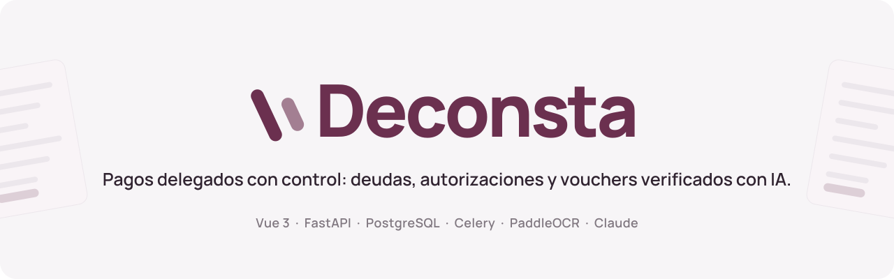
</picture>

<br>

**Un gerente delega el pago de sus deudas a su equipo sin perder el control:<br>cada deuda se respalda con su documento, cada pago con su voucher y cada decisión queda registrada.**

<br>


[Qué resuelve](#qué-resuelve) ·
[Recorrido](#recorrido) ·
[Cómo funciona](#cómo-funciona) ·
[Arquitectura](#arquitectura) ·
[Seguridad](#seguridad-y-privacidad) ·
[Probarlo](#probarlo-en-local) ·
[Alcance](#alcance)

</div>

---

## Qué resuelve

En una familia, un consultorio o una empresa pequeña, el dueño suele delegar los pagos del día a día
(luz, agua, internet, pensiones, arbitrios) a una asistente. El control termina repartido entre
WhatsApp, capturas de vouchers y una hoja de cálculo: nadie sabe qué venció, qué se pagó dos veces o
si el voucher que llegó es el que corresponde.

**Deconsta** convierte esa delegación en un flujo con reglas:

| | |
|---|---|
| **El documento manda** | Cada deuda nace de su recibo, boleta o cronograma. El sistema lo lee, propone los datos y revisa que sea original. |
| **El gerente pone los límites** | Un tope en soles y una lista de titulares autorizados. Lo que se sale de las reglas espera su autorización antes de pagarse. |
| **Cada pago trae su prueba** | La asistente sube el voucher y el sistema lo compara con la cuota: importe, código, empresa, titular, fecha y señales de alteración. |
| **Nada se pierde** | Cada acción queda en el historial con quién, qué y cuándo, y llega como aviso en tiempo real a quien tiene que decidir. |

## Recorrido

<table>
  <tr>
    <td width="50%" valign="top">
      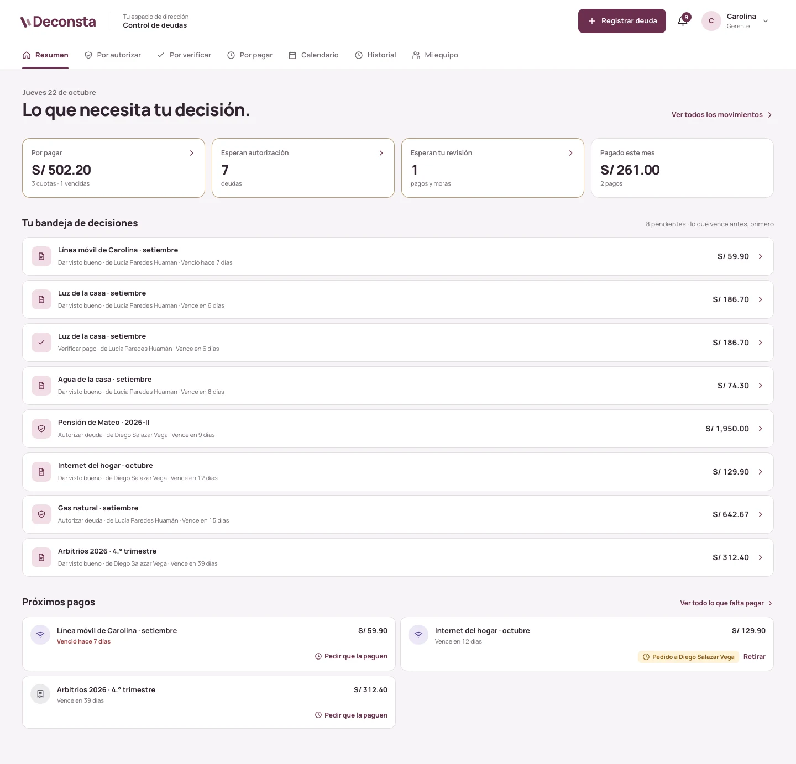
      <p align="center"><sub><b>Resumen de la gerencia.</b> Lo que espera su decisión, ordenado por vencimiento.</sub></p>
    </td>
    <td width="50%" valign="top">
      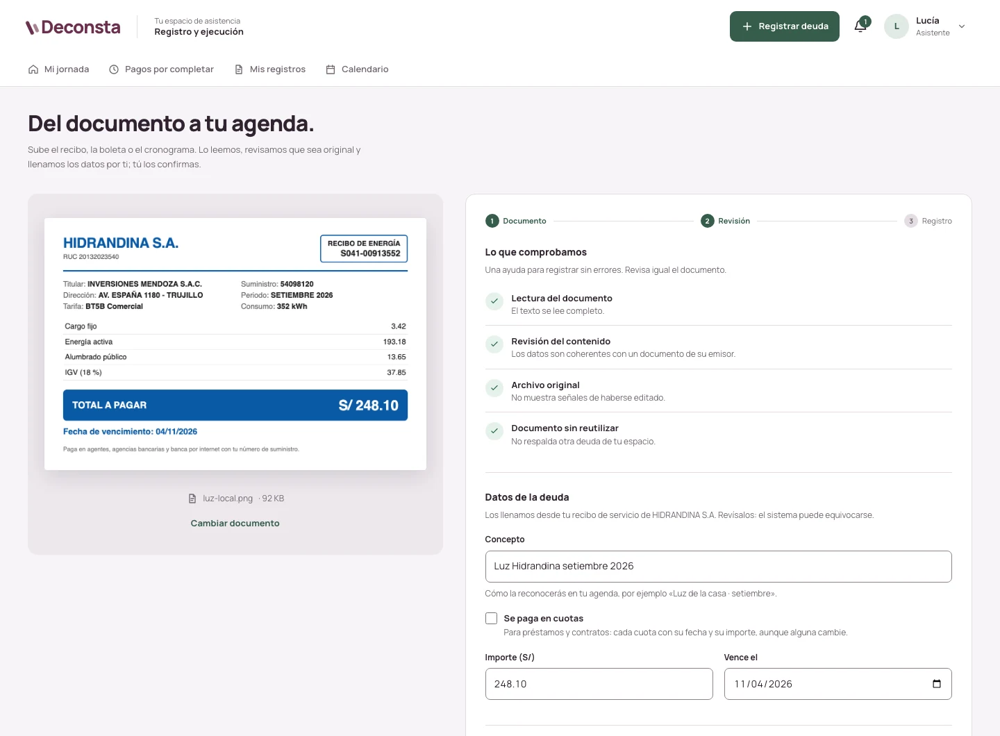
      <p align="center"><sub><b>Registro desde el documento.</b> OCR e IA llenan el formulario y revisan el recibo.</sub></p>
    </td>
  </tr>
  <tr>
    <td width="50%" valign="top">
      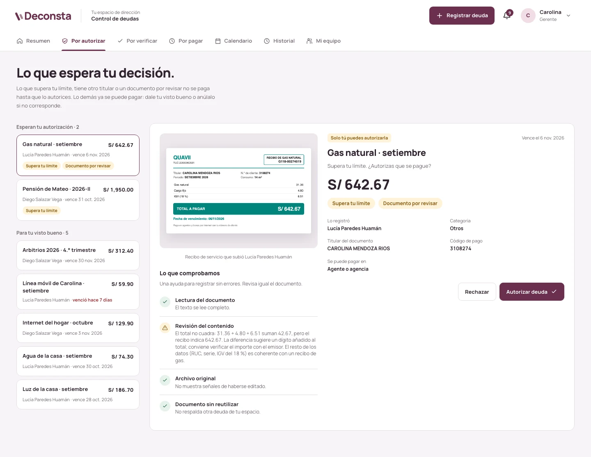
      <p align="center"><sub><b>Por autorizar.</b> La revisión detecta un total que no cuadra con sus conceptos.</sub></p>
    </td>
    <td width="50%" valign="top">
      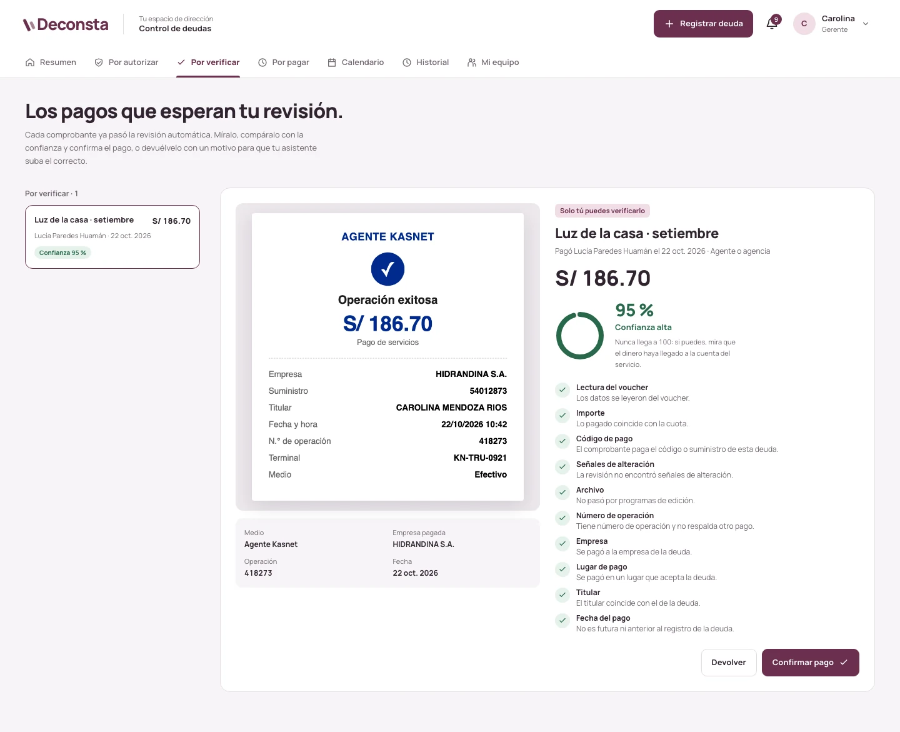
      <p align="center"><sub><b>Por verificar.</b> El voucher contra la cuota, criterio por criterio, con su confianza.</sub></p>
    </td>
  </tr>
  <tr>
    <td width="50%" valign="top">
      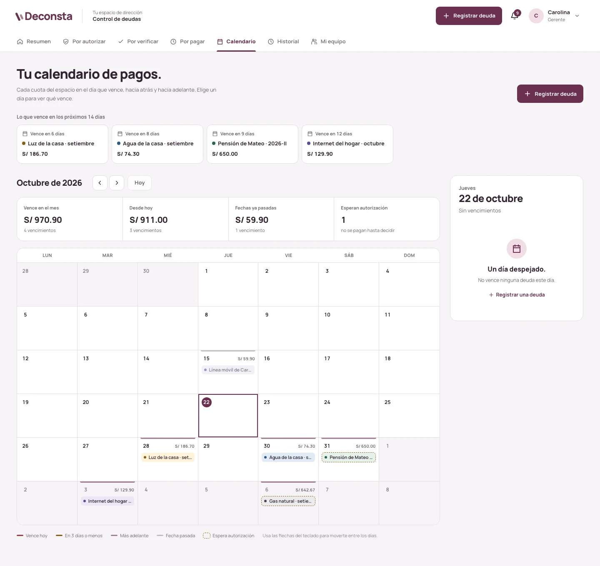
      <p align="center"><sub><b>Calendario.</b> Cada cuota en el día que vence, con lo vencido y lo que espera autorización.</sub></p>
    </td>
    <td width="50%" valign="top">
      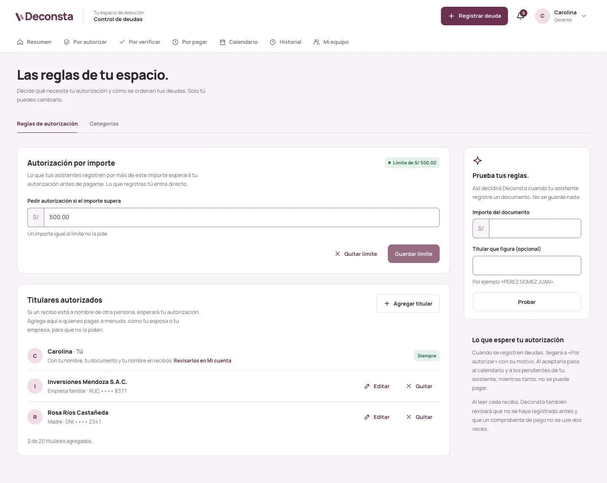
      <p align="center"><sub><b>Reglas.</b> Límite por importe, titulares autorizados y una prueba en vivo.</sub></p>
    </td>
  </tr>
</table>

<details>
<summary><b>Más pantallas</b>: historial y auditoría, equipo, jornada de la asistente, celular e ingreso</summary>
<br>

**Historial con auditoría.** Cada deuda muestra lo que pasó con ella, quién lo hizo y cuándo.

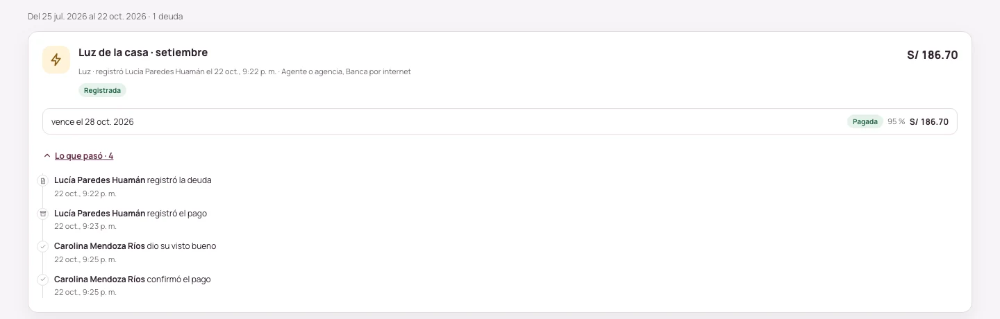

**Mi equipo.** Alta, bloqueo, restablecimiento de contraseña y eliminación de asistentes.

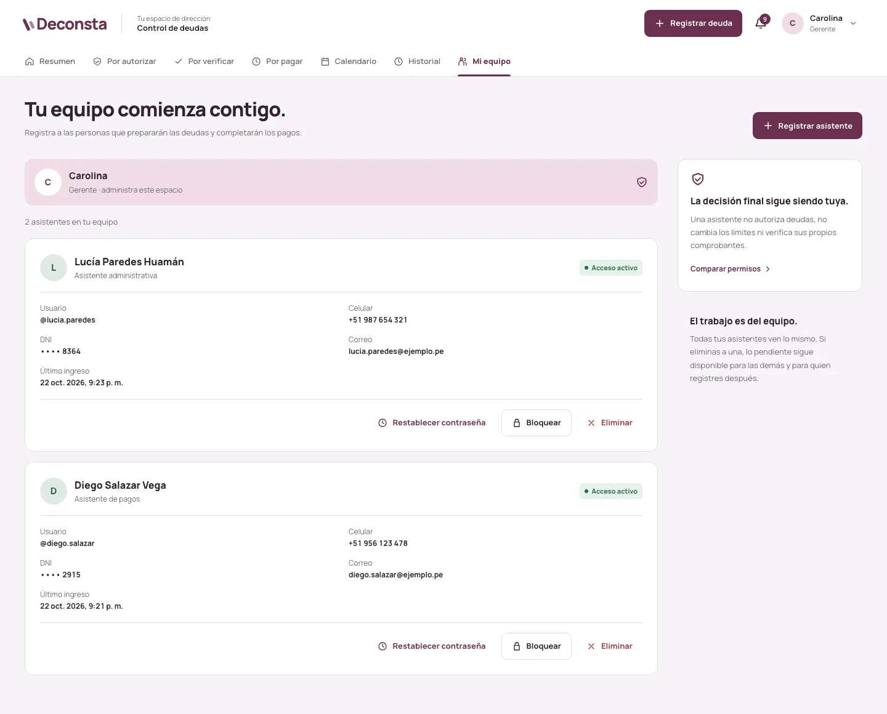

**La jornada de la asistente.** El acento cambia a eucalipto: la interfaz deja claro qué rol tiene la sesión.

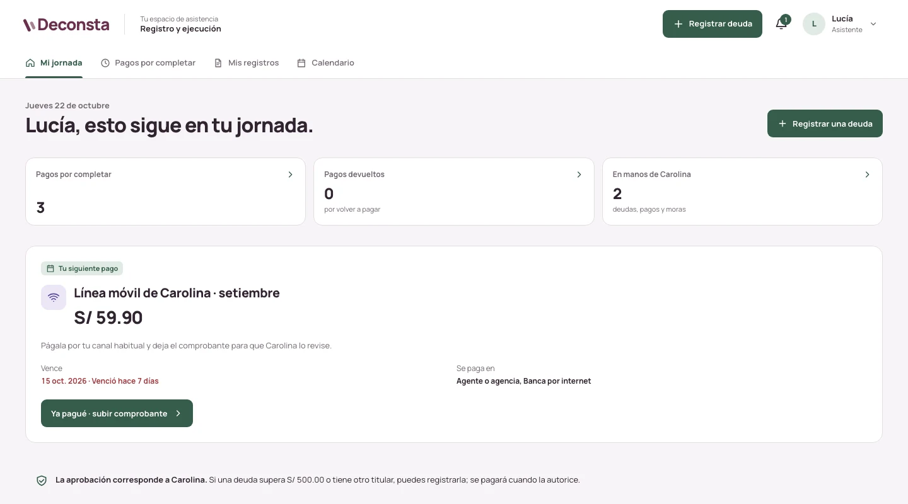

**En el celular.** La asistente suele pagar en la calle: todo el flujo funciona en pantallas pequeñas.

<p>
  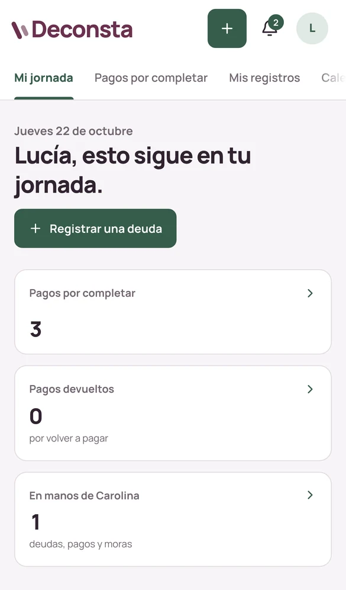
  &nbsp;
  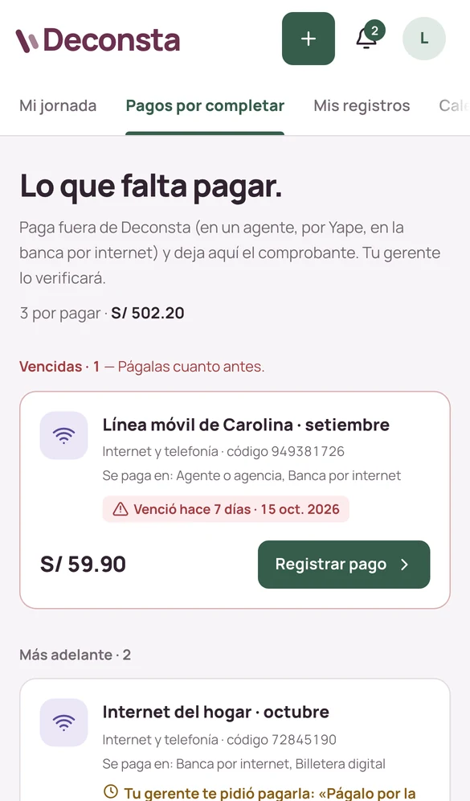
</p>

**Ingreso.**

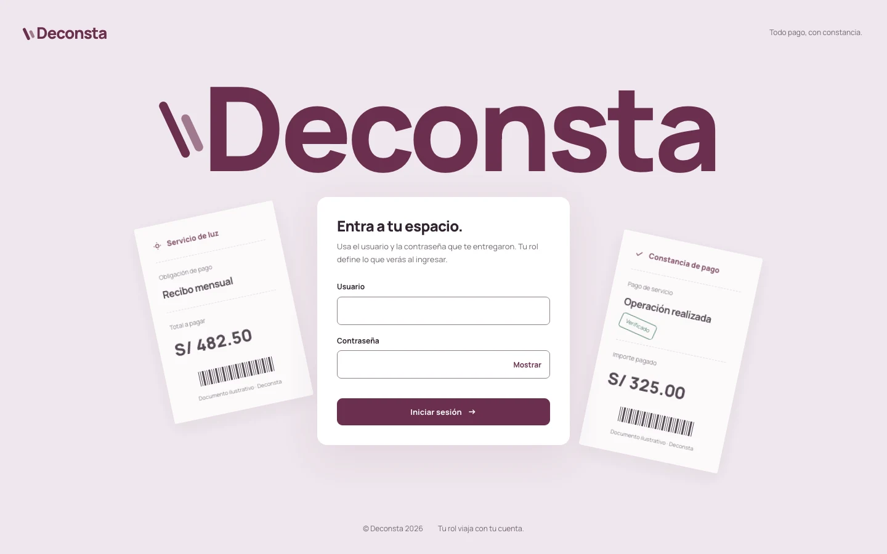

</details>

<sub>Las capturas usan personas, recibos y vouchers ficticios creados para la demostración.</sub>

## Cómo funciona

Hay dos roles. La **gerencia** pone las reglas y decide; la **asistencia** registra y paga. El backend
autoriza cada operación por rol: ocultar una pestaña solo ordena la interfaz.

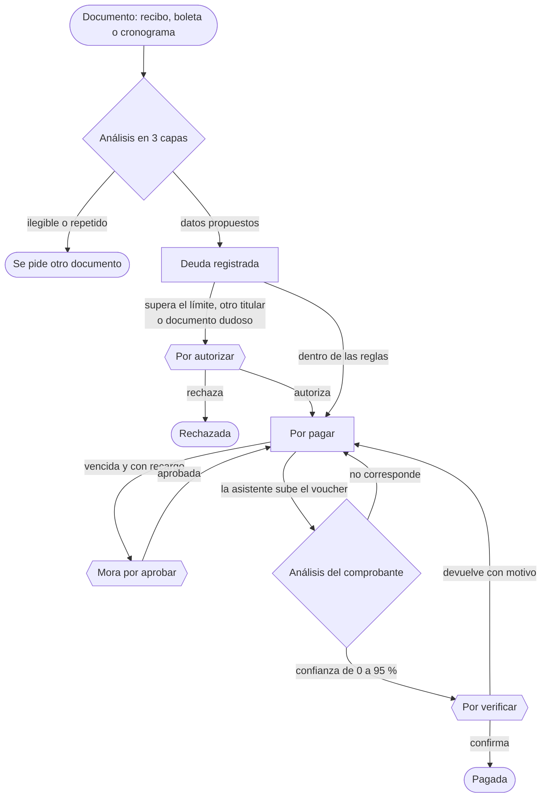

El gerente también puede **pedir** a una asistente concreta que pague una cuota, con una nota, y
cada paso llega como notificación a quien tiene que actuar.

<table>
<tr>
<td width="50%" valign="top">

**Gerencia**

- Resumen con su bandeja de decisiones y los próximos pagos
- Autoriza, rechaza o anula deudas con motivo
- Verifica pagos con la confianza de cada voucher, o los devuelve
- Aprueba o rechaza moras declaradas
- Pide a una asistente que pague una cuota concreta
- Límite en soles y titulares autorizados, con prueba en vivo
- Categorías con color e ícono
- Equipo: alta, bloqueo, restablecimiento y eliminación
- Historial con filtros, auditoría por deuda y exportación CSV
- Levanta los bloqueos por documentos repetidos o rechazados

</td>
<td width="50%" valign="top">

**Asistencia**

- Mi jornada: el siguiente pago y lo que espera a su gerente
- Registra deudas desde el documento, con cuotas y varios lugares de pago
- Paga fuera de Deconsta (agente, banca por internet, Yape) y sube el voucher
- Combina varios vouchers de un mismo pago en agente
- Declara la mora cobrada con su prueba
- Corrige a mano los datos de un voucher que no se pudo leer
- Mis registros y el calendario del espacio

**Ambos roles**

- Notificaciones en tiempo real (SSE)
- Mi cuenta: datos personales, usuario, contraseña, permisos y privacidad

</td>
</tr>
</table>

### El análisis de documentos

Cada archivo pasa por tres capas independientes. **Ninguna decide sola**: el dominio cruza sus
resultados y produce señales con un nivel de riesgo.

| Capa | Herramienta | Qué aporta |
|---|---|---|
| **Inspección** | pypdf · Pillow | Integridad, páginas, PDF protegido o con JavaScript, ediciones incrementales, software de edición en los metadatos, fechas incoherentes, bombas de descompresión. |
| **Lectura** | PaddleOCR (CPU) | El texto del documento, sin IA generativa. Sirve para contrastar lo que proponga la IA y para detectar documentos repetidos. |
| **Revisión** | Claude (salida estructurada) | Clasifica el documento, propone los datos de la deuda o del voucher y da un veredicto de autenticidad. El documento es un dato, nunca una instrucción. |

Con un voucher, la IA lo lee **sin saber qué se espera**: la comparación con la cuota la hace el
dominio. La confianza que ve el gerente sale de diez criterios con peso propio y nunca pasa de 95 %,
porque una captura no prueba del todo que el dinero llegó a la cuenta. Si la asistente escribió los
datos a mano porque la lectura falló, la confianza no pasa de 40 %.

## Arquitectura

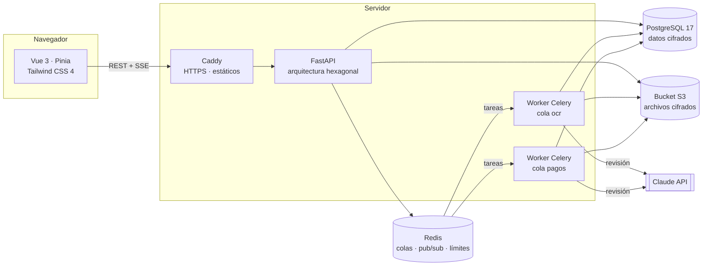

| Pieza | Por qué |
|---|---|
| **Monorepo** con pnpm y uv | Un solo `pnpm dev` levanta client, API y worker; `pnpm check` corre lint, tipos y pruebas de las dos partes. |
| **Hexagonal por módulo** | Cada módulo (`acceso`, `deudas`, `pagos`, `documentos`...) separa dominio, aplicación e infraestructura. Las reglas de negocio se prueban sin base de datos. |
| **SQL versionado** | 19 migraciones `NNNN_*.sql` con checksum y advisory lock: la API no arranca con un esquema a medias. |
| **Workers separados** | El OCR es lento y pesado en CPU. Dos colas (`ocr` para documentos y `pagos` para vouchers) para que un cronograma largo no frene la verificación de un pago. |
| **SSE sobre Redis pub/sub** | El aviso solo lleva el id: el contenido viaja por la API después de comprobar la sesión, y llega aunque lo publique otra réplica o el worker. |

Detalle de cada parte: **[client/README.md](client/README.md)** y **[server/README.md](server/README.md)**.

## Seguridad y privacidad

Deconsta guarda datos personales (DNI, celulares, recibos con direcciones) y documentos de pago, así
que la seguridad está en el diseño, no al final:

- **Cifrado en reposo.** Datos personales con AES-256-GCM y el contexto de la fila como dato asociado. Las búsquedas y la unicidad se hacen con huellas HMAC-SHA256, sin descifrar.
- **Archivos cifrados antes de salir del servidor.** El bucket nunca entrega enlaces públicos ni prefirmados: el archivo llega por la API, después de comprobar el permiso.
- **Contraseñas con Argon2id** (RFC 9106) y comparación en tiempo constante, aunque el usuario no exista.
- **Sesiones en cookie** `HttpOnly`, `Secure` y `SameSite=Strict`, en el mismo dominio que la API.
- **Límites de frecuencia** en Redis por origen, por usuario y por operación; bloqueo de cuentas por intentos fallidos.
- **Bloqueo por abuso.** Tres documentos o vouchers que no corresponden en 24 horas bloquean el registro hasta que el gerente lo levante.
- **Auditoría** de cada acción sobre deudas, pagos, cuentas y reglas.
- **Consentimiento versionado.** Términos y política de privacidad aceptados en el primer ingreso, en línea con la Ley 29733 de Protección de Datos Personales.
- **Entrada saneada.** Ningún texto admite caracteres de control ni invisibles (U+202E, U+200B); los logs no incluyen cuerpos, contraseñas ni datos personales.
- **CI con gitleaks, CodeQL, revisión de dependencias** y una auditoría semanal con `pnpm audit` y `pip-audit`.

## Calidad

| | |
|---|---|
| **Pruebas** | 280+ pruebas del server (dominio, casos de uso y API contra Postgres y Redis reales), 120+ del client con Vitest y flujos e2e con Playwright. |
| **Tipos** | TypeScript estricto con `vue-tsc` y Python con `mypy`. |
| **Estilo** | ESLint + oxlint + Prettier y Ruff, sin advertencias permitidas. |
| **CI** | Cada PR revisa commits convencionales, secretos, archivos pesados, CodeQL, dependencias, lint, tipos, pruebas con cobertura mínima y la construcción de las imágenes. |
| **Trabajo en ramas** | `feature/*`, `fix/*`, `perf/*`, `test/*` y `chore/*` hacia `dev`, con Husky y commitlint en local. |

## Probarlo en local

Requisitos: Node (versión de `.nvmrc`) con corepack, [uv](https://docs.astral.sh/uv/) y Docker.

```bash
corepack enable && pnpm install
(cd server && uv sync --group ocr)
cp server/.env.example server/.env    # genera las tres claves CLAVE_* (ver server/README.md)
pnpm services:up                       # Postgres, Redis y SeaweedFS (S3 local)
pnpm init:gerente --nombres "Ana" --apellidos "Torres" --correo ana@ejemplo.pe \
  --tipo-documento dni --numero-documento 45678912
pnpm dev                               # client, API y worker
```

Abre http://localhost:5173 e ingresa con el usuario y la contraseña temporal que imprimió
`init:gerente`. Desde **Mi equipo** registras a tus asistentes.

> [!TIP]
> Para probar la revisión con IA sin clave de la API, pon `IA_PROVEEDOR=claude_code` en
> `server/.env` y ten iniciada tu sesión de [Claude Code](https://claude.com/claude-code): el worker
> la usa para revisar los documentos. Sin IA, el OCR y la inspección siguen funcionando y lo que
> registra una asistente espera la autorización del gerente.

## Alcance

**Lo que Deconsta es hoy:** un espacio de trabajo por gerente, con sus asistentes, que cubre el ciclo
completo de una deuda: registro desde el documento, autorización, pedido de pago, comprobante,
verificación, mora e historial.

**Lo que deliberadamente no hace:**

- **No mueve dinero.** El pago se hace por el canal de siempre (agente, banca, billetera) y Deconsta lo respalda y verifica. No se conecta con bancos.
- **No es multiempresa todavía.** Cada despliegue sirve a un gerente y su equipo.
- **No es contabilidad.** No emite comprobantes electrónicos ni declara impuestos.

**Hacia dónde podría crecer:** espacios multiempresa para ofrecerlo como servicio, recordatorios por
correo o WhatsApp, deudas recurrentes que se registran solas cada mes, conciliación con el estado de
cuenta bancario y una app móvil para la asistencia.

## Equipo

Proyecto desarrollado en la Universidad Privada Antenor Orrego (UPAO), Trujillo, Perú.

| | Rol |
|---|---|
| **[Johel Andreé Vargas Villanueva](https://github.com/andr2116d)** | Desarrollo principal: arquitectura, backend, frontend, análisis de documentos, diseño de la interfaz e infraestructura |
| **[Hrid Arav Sigüeñas Loja](https://github.com/Hrid1402)** | Desarrollo |
| **Nicolás Romero Castillo** | Desarrollo |

## Licencia

© 2026 Johel Andreé Vargas Villanueva, Hrid Arav Sigüeñas Loja y Nicolás Romero Castillo.
**Todos los derechos reservados.**

Puedes leer el código, clonarlo y ejecutarlo en tu equipo para evaluarlo. No está permitido
redistribuirlo, publicarlo como propio, desplegarlo para terceros ni usarlo con fines comerciales
sin autorización escrita de los autores. Ver [LICENSE](LICENSE).
