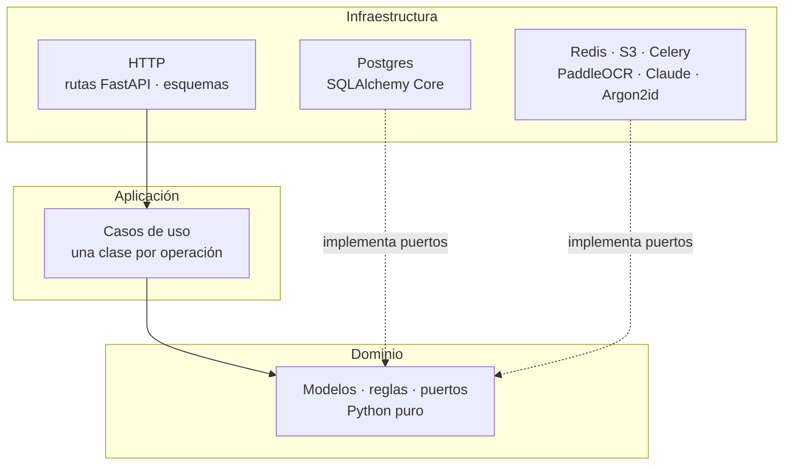
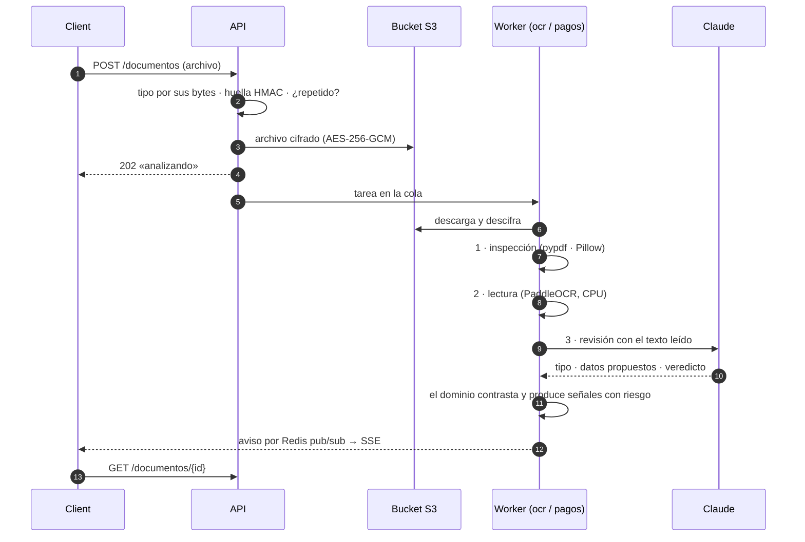
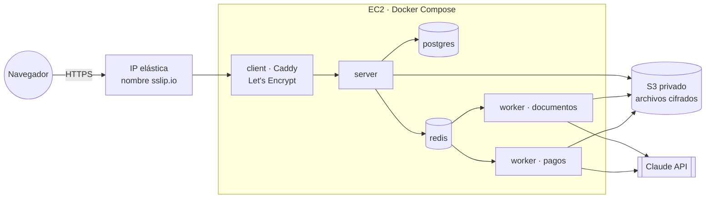

<div align="center">

<picture>
  <source media="(prefers-color-scheme: dark)" srcset="../.github/assets/marca/logo-oscuro.svg">
  
</picture>

### Server · API y workers

Python 3.12 · FastAPI · SQLAlchemy Core · PostgreSQL 17 · Redis · Celery · PaddleOCR · Claude

[Arquitectura](#arquitectura) ·
[Análisis de documentos](#análisis-de-documentos) ·
[Seguridad](#seguridad) ·
[Preparar](#preparar) ·
[API](#api) ·
[Reglas del negocio](#reglas-del-negocio) ·
[Despliegue](#despliegue)

</div>

---

La API concentra **toda** la autoridad de Deconsta: quién ve qué, qué espera autorización, cuándo un
voucher respalda un pago. El client solo muestra lo que el server decide. Las dependencias se
manejan con [uv](https://docs.astral.sh/uv/).

## Arquitectura

**Hexagonal por módulo.** Cada módulo de negocio tiene tres capas y las dependencias apuntan hacia
adentro: el dominio no conoce FastAPI, Postgres ni Claude.



```txt
app/
  core/            configuración, base de datos, migraciones, errores, registro y saneamiento
  acceso/          sesiones, contraseñas, equipo, cuenta, incorporación y auditoría
  categorias/      categorías del espacio
  reglas/          límite en soles, titulares autorizados y su evaluación
  documentos/      subida, análisis en tres capas, repetidos y bloqueos del registro
  deudas/          registro, cuotas, lugares de pago, decisiones y calendario
  pagos/           por pagar, comprobantes, pagos, confianza, moras, pedidos y bloqueos
  historial/       consulta con filtros, auditoría por deuda y exportación CSV
  panel/           resumen de la gerencia y jornada de la asistencia
  notificaciones/  notificaciones persistentes y avisos en tiempo real (Redis + SSE)
  workers/         aplicación de Celery y sus colas
  contenedor.py    conecta cada caso de uso con sus adaptadores
migraciones/       NNNN_descripcion.sql
tests/             dominio, casos de uso y API contra Postgres y Redis reales
```

Cada módulo sigue la misma forma: `dominio/` (modelos, reglas, errores y puertos),
`aplicacion/` (casos de uso) e `infraestructura/` (persistencia, HTTP y adaptadores externos). Las
escrituras usan una unidad de trabajo por operación y toman con `FOR UPDATE` la fila que decide la
concurrencia (la deuda, el gerente), así una segunda decisión simultánea responde 409.

## Análisis de documentos

Un documento de deuda o un voucher de pago se sube a la API, se cifra, se guarda en el bucket y se
encola. El worker lo analiza en tres capas y el **dominio** cruza los resultados:



| Riesgo | Documento de deuda | Voucher de pago |
|---|---|---|
| **Bajo** | Se registra con los datos propuestos | Respalda el pago con su confianza |
| **Medio** | La deuda espera la autorización del gerente | Sirve, pero baja la confianza que ve el gerente |
| **Alto** | Rechazado si lo sube una asistente; al gerente solo se le advierte | Rechazado: otro importe, otro código, fecha imposible o alteración |

**La confianza de un pago** sale de diez criterios con peso propio (`pagos/dominio/confianza.py`):
lectura, importe, código de pago y alteración pesan 3; archivo, número de operación y empresa, 2;
lugar, titular y fecha, 1. Bien vale completo, sin dato la mitad y con aviso nada. Se escala a
**95 como máximo**, porque una captura no prueba que el dinero llegó a la cuenta, y a 40 si los datos
se escribieron a mano.

**Con la IA, el documento es un dato, nunca una instrucción.** Claude recibe el archivo y el texto
de PaddleOCR, responde con salida estructurada y lo que propone se contrasta con lo leído: un
importe o un código que no aparecen en el texto son una señal. A un voucher la IA lo lee **a
ciegas**, sin saber qué cuota dice pagar.

## Seguridad

| Tema | Cómo |
|---|---|
| Datos personales | AES-256-GCM con el contexto (tabla, campo, id) como dato asociado; búsqueda y unicidad con huellas HMAC-SHA256 (`acceso/infraestructura/cifrado.py`) |
| Archivos | Cifrados en la aplicación antes de subir, con la clave del objeto como contexto; sin enlaces públicos ni prefirmados; se entregan con `no-store` y una CSP sin scripts |
| Contraseñas | Argon2id (RFC 9106); hash ficticio para igualar tiempos cuando el usuario no existe |
| Sesión | Cookie `HttpOnly`, `Secure` y `SameSite=Strict`; bloqueo de la asistente al quinto intento fallido |
| Abuso | Límites por origen, usuario y operación en Redis (ventana atómica con Lua, compartida entre réplicas); bloqueo del registro tras 3 documentos o vouchers que no corresponden en 24 h |
| Entrada | Tope de tamaño del cuerpo; ningún texto admite caracteres de control ni invisibles; importes como `Decimal`, nunca `float` |
| Registro | `X-Request-ID` por solicitud; los logs no incluyen cuerpos, contraseñas ni datos personales; SQLAlchemy con `hide_parameters` |
| Auditoría | Cada acción sobre cuentas, reglas, categorías, deudas y pagos, con quién, cuándo y motivo; de los datos personales solo se guarda qué campo cambió |
| Errores | Estructura única `{"code", "detail", "fields"?}`; los internos llevan una referencia, sin trazas |

## Preparar

```sh
uv sync                # crea .venv e instala dependencias (incluye el grupo dev)
uv sync --group ocr    # además PaddleOCR, solo para el worker
cp .env.example .env
# Genera tres claves distintas para CLAVE_CIFRADO_DATOS, CLAVE_HUELLA_DATOS y
# CLAVE_CIFRADO_ARCHIVOS:
python -c "import base64,secrets;print(base64.b64encode(secrets.token_bytes(32)).decode())"
```

> [!CAUTION]
> Las claves cifran los datos personales y los documentos en reposo: **si se pierden, esos datos no
> se recuperan.** En producción viven en el gestor de secretos del despliegue, nunca en el
> repositorio.

### Configuración

Todas las variables están documentadas en [`.env.example`](.env.example). Las principales:

| Grupo | Variables |
|---|---|
| Entorno | `ENTORNO` (`desarrollo` · `pruebas` · `produccion`), `TIMEZONE`, `NIVEL_REGISTRO`, `MIGRAR_AL_INICIAR` |
| Servicios | `DATABASE_URL`, `REDIS_URL`, `CORS_ORIGINS` |
| Cifrado | `CLAVE_CIFRADO_DATOS`, `CLAVE_HUELLA_DATOS`, `CLAVE_CIFRADO_ARCHIVOS` |
| Bucket | `S3_ENDPOINT`, `S3_REGION`, `S3_BUCKET`, `S3_ACCESS_KEY`, `S3_SECRET_KEY`, `S3_ESTILO_RUTA` |
| IA y OCR | `IA_PROVEEDOR` (`api` · `claude_code`), `ANTHROPIC_API_KEY`, `IA_MODELO`, `IA_ESFUERZO`, `OCR_HILOS` |
| Sesión | `SESION_DURACION_MINUTOS`, `COOKIE_SESION_NOMBRE`, `COOKIE_SEGURA` |
| Límites | `LIMITE_*` y `VENTANA_*_SEGUNDOS` por operación |

`ANTHROPIC_API_KEY` sale de la Claude Console (una suscripción de Claude no sirve para una app
desplegada). Sin ella, la revisión con IA queda incompleta y lo que registra una asistente espera la
autorización del gerente.

En desarrollo, `IA_PROVEEDOR=claude_code` prueba la revisión con IA sin clave: el worker ejecuta
`claude -p` con la sesión de Claude Code de esa PC. Corre sin herramientas, sin MCP, sin
configuración y en una carpeta vacía, y el documento viaja por la entrada estándar. En producción
solo se acepta `IA_PROVEEDOR=api`.

## Comandos

```sh
uv run uvicorn app.main:app --reload --port 8000   # API en desarrollo
uv run --group ocr celery -A app.workers.celery_app:celery_app worker -Q ocr,pagos --concurrency=1
uv run pytest                                      # pruebas (usan Postgres y Redis de compose)
uv run ruff check . && uv run ruff format .        # lint y formato
uv run mypy app                                    # tipos
uv run python -m app.core.migraciones estado       # migraciones aplicadas y pendientes
uv run python -m app.core.migraciones aplicar      # aplicar sin arrancar la API
PRUEBAS_OCR=1 uv run --group ocr pytest tests/test_adaptadores_documentos.py   # con PaddleOCR real
PRUEBAS_CLAUDE_CODE=1 uv run pytest tests/test_revisor_claude_code.py            # con Claude Code real
```

Desde la raíz del monorepo, `pnpm dev` levanta la API y el worker junto con el client, y
`pnpm check` corre el lint, los tipos y las pruebas de las dos partes.

## API

Todas las rutas viven bajo `/api/v1`. La documentación interactiva está en
http://localhost:8000/docs mientras corre la API (en producción Caddy no la expone).

<details>
<summary><b>Acceso y sesión</b> · 7 rutas</summary>

| Ruta | Descripción |
|---|---|
| `POST /auth/login` | Inicia sesión y deja el token en una cookie HttpOnly |
| `GET /auth/me` | Usuario de la sesión |
| `POST /auth/logout` | Cierra la sesión |
| `POST /auth/contrasena` | Cambia la contraseña (pide la actual) |
| `GET /documentos-legales` | Términos y política vigentes, con su aceptación |
| `POST /documentos-legales/aceptacion` | Acepta las versiones vigentes (`{tipo, version}`) |
| `GET /espacio` | Entrada al espacio; exige la incorporación completa |

</details>

<details>
<summary><b>Mi cuenta</b> · 4 rutas</summary>

| Ruta | Descripción |
|---|---|
| `GET /cuenta` | Datos de la propia cuenta, descifrados, y el cupo de cambios de usuario |
| `POST /cuenta/confirmacion-datos` | La asistente confirma sus datos en su primer ingreso |
| `POST /cuenta/datos` | Actualiza los datos personales (envía los datos completos) |
| `POST /cuenta/nombre-usuario` | Cambia el usuario (pide la contraseña actual) |

</details>

<details>
<summary><b>Mi equipo</b> · 7 rutas</summary>

| Ruta | Descripción |
|---|---|
| `GET /asistentes` | Asistentes del equipo (documento enmascarado) |
| `POST /asistentes` | Registra una asistente y entrega su usuario y contraseña una sola vez |
| `POST /asistentes/{asistente_id}/bloqueo` | El gerente bloquea a su asistente y cierra sus sesiones |
| `POST /asistentes/{asistente_id}/desbloqueo` | El gerente desbloquea a su asistente |
| `POST /asistentes/{asistente_id}/eliminacion` | Baja lógica: deja de ingresar, se conserva su historial |
| `POST /asistentes/{asistente_id}/restablecimiento` | Contraseña temporal nueva para una asistente que olvidó la suya |
| `POST /asistentes/{asistente_id}/recuperacion` | Recupera una eliminada con una contraseña temporal nueva |

</details>

<details>
<summary><b>Categorías y reglas</b> · 11 rutas</summary>

| Ruta | Descripción |
|---|---|
| `GET /categorias` | Categorías activas del espacio; `?archivadas=true` suma las archivadas (gerente) |
| `POST /categorias` | El gerente crea una categoría |
| `POST /categorias/{categoria_id}/edicion` | Cambia nombre y descripción; sin color o ícono conserva los actuales |
| `POST /categorias/{categoria_id}/archivado` | La retira de las deudas nuevas, con motivo opcional |
| `POST /categorias/{categoria_id}/reactivacion` | Vuelve a ofrecerla |
| `GET /reglas` | Límite y titulares autorizados del gerente (documentos enmascarados) |
| `POST /reglas/limite` | Fija el límite (`"2900.50"`, como texto) o lo quita (`null`) |
| `POST /reglas/titulares` | Agrega un titular autorizado (pide `autorizacion_declarada`) |
| `POST /reglas/titulares/{titular_id}/edicion` | Cambia nombre y relación; el documento no se edita |
| `POST /reglas/titulares/{titular_id}/eliminacion` | Baja lógica, con motivo opcional |
| `POST /reglas/evaluacion` | Prueba las reglas con un documento de ejemplo; no guarda nada |

</details>

<details>
<summary><b>Documentos</b> · 5 rutas</summary>

| Ruta | Descripción |
|---|---|
| `POST /documentos` | Sube el documento (multipart `archivo`); responde 202 «analizando» |
| `GET /documentos/{documento_id}` | Estado, señales y datos propuestos del análisis |
| `GET /documentos/{documento_id}/contenido` | El archivo descifrado, para quien lo subió y su gerente |
| `GET /registro-deudas/bloqueos` | Asistentes con el registro de deudas bloqueado (gerente) |
| `POST /registro-deudas/bloqueos/{asistente_id}/levantamiento` | El gerente levanta el bloqueo |

</details>

<details>
<summary><b>Deudas</b> · 8 rutas</summary>

| Ruta | Descripción |
|---|---|
| `POST /deudas` | Registra una deuda desde un documento listo |
| `GET /deudas` | Deudas del espacio (gerente) o las propias (asistente); `?pendientes=true` |
| `GET /deudas/calendario` | Cuotas que vencen entre `desde` y `hasta` (hasta 62 días) |
| `GET /deudas/{deuda_id}` | Detalle con sus cuotas y el análisis de su documento |
| `POST /deudas/{deuda_id}/autorizacion` | El gerente autoriza lo que espera su autorización |
| `POST /deudas/{deuda_id}/rechazo` | La rechaza, con motivo |
| `POST /deudas/{deuda_id}/revision` | Le da su visto bueno: sale de sus pendientes |
| `POST /deudas/{deuda_id}/anulacion` | La anula, con motivo |

</details>

<details>
<summary><b>Pagos, moras y pedidos</b> · 20 rutas</summary>

| Ruta | Descripción |
|---|---|
| `POST /pagos/moras` | Declara la mora de una cuota vencida con su prueba |
| `GET /pagos/moras` | Moras del espacio; `?estado=` |
| `GET /pagos/moras/{mora_id}` | Detalle de la mora |
| `POST /pagos/moras/{mora_id}/aprobacion` | El gerente aprueba la mora |
| `POST /pagos/moras/{mora_id}/rechazo` | El gerente la rechaza, con motivo |
| `GET /pagos/pedidos` | Pedidos de pago pendientes |
| `POST /pagos/pedidos` | El gerente pide a una asistente que pague una cuota, con nota |
| `POST /pagos/pedidos/{pedido_id}/retiro` | Retira el pedido |
| `GET /pagos/por-pagar` | La próxima cuota sin pagar de cada deuda registrada |
| `POST /pagos/comprobantes` | Sube un voucher o, con `proposito=mora`, la prueba de una mora; responde 202 |
| `GET /pagos/comprobantes/{comprobante_id}` | Estado, señales y lectura del comprobante |
| `POST /pagos/comprobantes/{comprobante_id}/datos` | Datos escritos a mano de un voucher que no se pudo leer |
| `GET /pagos/comprobantes/{comprobante_id}/contenido` | El archivo descifrado, sin caché ni scripts |
| `POST /pagos` | Registra el pago de una cuota con uno o varios comprobantes |
| `GET /pagos` | Pagos del espacio, los más recientes primero; `?estado=` |
| `GET /pagos/{pago_id}` | Detalle del pago; la confianza solo la ve el gerente |
| `POST /pagos/{pago_id}/confirmacion` | El gerente confirma el pago |
| `POST /pagos/{pago_id}/devolucion` | El gerente lo devuelve con motivo para que se suba el correcto |
| `GET /registro-pagos/bloqueos` | Asistentes con el registro de pagos bloqueado (gerente) |
| `POST /registro-pagos/bloqueos/{asistente_id}/levantamiento` | El gerente levanta el bloqueo |

</details>

<details>
<summary><b>Historial, panel y notificaciones</b> · 7 rutas</summary>

| Ruta | Descripción |
|---|---|
| `GET /notificaciones` | Las últimas 50 y cuántas faltan leer |
| `POST /notificaciones/lectura` | Marca todas como leídas |
| `POST /notificaciones/{notificacion_id}/lectura` | Marca una como leída; `POST /notificaciones/lectura`, todas |
| `GET /notificaciones/flujo` | Avisos en tiempo real (Server-Sent Events) |
| `GET /historial` | Deudas con sus cuotas, pagos, moras y auditoría, con filtros |
| `GET /historial/exportacion` | El mismo historial en CSV |
| `GET /panel` | Resumen de la gerencia o jornada de la asistencia |

</details>

Los errores siguen siempre `{"code", "detail", "fields"?}`. La asistente se bloquea al quinto
intento fallido hasta que su gerente la desbloquee; el gerente no se bloquea. Aparte, el rate
limiting por IP y por usuario (en Redis, compartido entre instancias) responde 429 con
`Retry-After`.

Detrás de un proxy, arranca uvicorn con `--proxy-headers --forwarded-allow-ips=<ip del proxy>`
para que el límite por IP use la IP real del cliente. En producción: `ENTORNO=produccion`,
`COOKIE_SEGURA=true` y HTTPS en el borde.


## Reglas del negocio

Cada regla vive en el `dominio` de su módulo y tiene sus pruebas. Este es el detalle para quien
mantenga el código.

<details>
<summary><b>Migraciones</b></summary>

Cada archivo `migraciones/NNNN_descripcion.sql` es una versión. Al arrancar, la API toma un
advisory lock de Postgres, aplica en orden las pendientes (cada una en su transacción) y las
registra en `migracion_aplicada` con su checksum. Si una falla, se revierte y la API no arranca.
Una migración aplicada no se edita: los cambios van en un archivo nuevo.

</details>

<details>
<summary><b>Cuentas</b></summary>

```sh
uv run python -m app.acceso.infraestructura.cli crear-gerente --nombres "Valentina" \
  --apellidos "Ramos Díaz" --correo valentina@ejemplo.pe --tipo-documento dni \
  --numero-documento 45678912 [--telefono 987654321] [--usuario valentina.ramos] \
  [--cargo "Gerente general"]
uv run python -m app.acceso.infraestructura.cli crear-asistente --gerente valentina.ramos ...
```

Imprime el id, el usuario y una contraseña temporal. `--tipo-documento` acepta `dni` o `ce`. El
cargo lo fija quien crea la cuenta; la persona no puede editarlo.

</details>

<details>
<summary><b>Primer ingreso</b></summary>

Antes de entrar a su espacio, cada cuenta acepta los términos de uso y la política de privacidad
vigentes. Una asistente registrada desde Mi equipo (o recuperada) además confirma sus datos
(`completar_datos`): completa su correo y revisa lo que registró su gerente; en esa primera
confirmación aún puede corregir su documento. La sesión informa lo que falta en `pasos_pendientes`; mientras quede algo, las rutas de
trabajo (`GerenteDep`, `SesionHabilitadaDep`) responden 403 `INCORPORACION_PENDIENTE`.

Cambiar la contraseña temporal no bloquea el espacio: la sesión lo indica con
`debe_cambiar_contrasena` y el client lo recuerda en cada ingreso hasta que se cambie.

Los documentos viven en `documento_legal` con su versión y no se editan. Para cambiar un texto,
crea una migración que inserte la versión siguiente (puede llevar `vigente_desde` futura): desde
que rige, todas las cuentas deben volver a aceptarla. Las aceptaciones quedan en
`aceptacion_documento` (cuenta, versión y fecha) y no se pueden modificar.

</details>

<details>
<summary><b>Mi equipo</b></summary>

El gerente administra a sus asistentes; cualquier otra cuenta responde 404. Las reglas viven en
`acceso/aplicacion/equipo.py`:

- Al registrar, el gerente da nombres, apellidos, celular y documento; el cargo es opcional. El
  usuario y la contraseña los elige él (se validan) o los genera Deconsta. Se muestran una sola vez.
- Una persona no puede tener dos cuentas vigentes: si ya está en el equipo (activa o bloqueada)
  responde `PERSONA_YA_EN_EQUIPO`; si es de otra cuenta, `DATOS_DUPLICADOS` sin decir de quién.
- Eliminar es una baja lógica (`eliminada_en`): la cuenta no ingresa (responde como inexistente),
  sus sesiones se cierran y el historial se conserva. Registrar de nuevo a esa persona responde
  `ASISTENTE_ELIMINADA` con `deleted_account`, para elegir entre recuperarla o crear otra con
  `crear_aunque_eliminada: true`. Recuperarla le da una contraseña temporal nueva y vuelve a
  pedirle confirmar sus datos.
- Restablecer la contraseña genera una temporal nueva (se muestra una sola vez), invalida la anterior,
  cierra sus sesiones y queda en la auditoría como `CONTRASENA_RESTABLECIDA` con su motivo. No
  levanta un bloqueo: eso se hace con el desbloqueo.
- Bloquear (causa `gerente`) cierra sus sesiones; el bloqueo por 5 intentos fallidos tiene la causa
  `intentos_fallidos`. El mensaje de ingreso dice cuál fue.
- El trabajo será del equipo, no de una asistente: eliminar a una no deja nada sin responsable.

</details>

<details>
<summary><b>Categorías</b></summary>

Ordenan las deudas del espacio (agua, luz, tarjetas…) para filtrarlas, resumirlas y exportarlas.
Son del espacio del gerente y las comparte su equipo. Las reglas viven en `categorias/dominio`:

- El gerente las crea, edita, archiva y reactiva; sus asistentes consultan las activas y crean
  nuevas (al registrar una deuda que no encaja), pero no las editan, archivan ni reactivan. El
  espacio sale de la sesión: la categoría de otro espacio responde 404 `CATEGORIA_NO_ENCONTRADA`.
- Nombre de 2 a 40 caracteres (letras, números, espacios y `. , & / ( ) ' + -`), único en el
  espacio sin distinguir mayúsculas, tildes ni espacios repetidos. Uno repetido responde 409
  `CATEGORIA_DUPLICADA`; si la otra está archivada, `existing_category` permite reactivarla.
- Descripción opcional de hasta 200 caracteres: qué documentos van ahí (servirá para la
  clasificación automática de los recibos). Color e ícono salen de catálogos fijos; sin ellos se
  asignan el siguiente color de la paleta y una etiqueta.
- Nunca se borran: archivar las retira de las deudas nuevas. Una archivada no se edita
  (`CATEGORIA_ARCHIVADA`) hasta reactivarla. Hay un tope de 50 activas (`LIMITE_CATEGORIAS`).
- Cada escritura toma la fila del gerente con `FOR UPDATE`, cuenta para el límite
  `LIMITE_GESTION_CATEGORIAS` y queda en la auditoría (`CATEGORIA_CREADA`, `_EDITADA`,
  `_ARCHIVADA`, `_REACTIVADA`) con quién, cuándo, el motivo y, al editar, el antes y el después.

</details>

<details>
<summary><b>Reglas de autorización</b></summary>

Deciden qué de lo que registra una asistente espera la autorización del gerente. Solo el gerente
las consulta y las cambia. Las reglas viven en `reglas/dominio`:

- **Importe.** Espera autorización lo que supera el límite (estrictamente mayor). Sin límite, el
  importe no detiene nada. Los importes son soles con dos decimales, como texto y `Decimal`, nunca
  `float`; hasta S/ 9,999,999.99.
- **Titular.** Espera autorización el documento cuyo titular no es el gerente (su nombre, su
  documento y su nombre en recibos de Mi cuenta) ni un titular autorizado. Un documento sin
  titular legible (una boleta de menos de S/ 700 no identifica al comprador) no se marca.
- **Comparación de titulares.** Primero por documento: dos documentos distintos son dos personas, y
  un RUC 10 reconoce el DNI que contiene. Si falta alguno, por nombre: sin importar orden, tildes,
  mayúsculas, partículas («de», «los») ni iniciales («PEREZ GOMEZ JUAN C»), con al menos dos
  palabras completas.
- **Lo que registra el gerente** no espera a nadie; un titular distinto solo se le avisa.
- **Titulares autorizados.** Nombre (persona o razón social) y documento opcional: DNI, carné o RUC
  con su dígito verificador. Son datos personales de terceros (Ley 29733): exigen
  `autorizacion_declarada` (se guarda su fecha), se cifran con AES-256-GCM, se buscan por huellas
  HMAC, solo salen enmascarados y nunca van a la auditoría. No se repiten por nombre ni por
  documento, el gerente no puede agregarse a sí mismo (`TITULAR_ES_GERENTE`) y hay un tope de 20.
- Cada cambio toma la fila del gerente con `FOR UPDATE`, cuenta para `LIMITE_GESTION_REGLAS` y queda
  en la auditoría: `LIMITE_AUTORIZACION_CAMBIADO` (antes y después), `TITULAR_AUTORIZADO_AGREGADO`,
  `_EDITADO` (qué campos) y `_QUITADO` (con su motivo).

`reglas.dominio.evaluacion.evaluar` es la regla que aplica el registro de deudas, y
`POST /reglas/evaluacion` la expone para que el gerente la pruebe.

</details>

<details>
<summary><b>Documentos de las deudas</b></summary>

Toda deuda nace de un documento legible (recibo, boleta, factura, cronograma, papeleta, tributo).
Las reglas viven en `documentos/dominio`:

- **Archivo.** PDF, JPG, PNG o WebP de hasta 10 MB y 10 páginas; el tipo sale de sus primeros
  bytes. Un PDF con contraseña o dañado, o una imagen diminuta, se rechaza con su código.
- **Guardado.** Se cifra con AES-256-GCM (`CLAVE_CIFRADO_ARCHIVOS`, con la clave del objeto como
  contexto) y va a un bucket privado compatible con S3. El navegador nunca recibe enlaces: el
  archivo sale por la API, solo para quien lo subió y su gerente, con `no-store` y una CSP sin
  scripts. El nombre original y lo leído (titular, código de pago) se guardan cifrados.
- **Análisis**, en el worker de la cola `ocr` (`documentos.analizar`, con reintentos; si los
  agota, el documento queda `fallido`):
  1. PaddleOCR lee el texto. Si no se lee, es `ilegible`: no se registra ni se llega a la IA.
  2. Claude (`IA_MODELO`, por defecto `claude-sonnet-5-5`) clasifica, propone los datos (concepto,
     emisor, titular, código de pago, importe, vencimiento, cuotas de un cronograma, categoría y
     lugar de pago) y da un veredicto. El documento es un dato, nunca una instrucción. Lo
     propuesto se contrasta con el texto leído: un importe o un código que no aparece es una señal.
  3. Metadatos: editores de imágenes (riesgo alto), editores de PDF, procesadores de texto, PDF
     guardados después de generarse o con JavaScript (riesgo medio).
- **Riesgo.** Alto: lo que sube una asistente queda `rechazado`; al gerente solo se le advierte.
  Medio (incluida la revisión con IA incompleta): la deuda espera la autorización del gerente.
- **Repetidos.** Un documento respalda una sola deuda del espacio: lo impiden la huella HMAC del
  archivo, la clave de negocio (emisor y serie y número; empresa, suministro y periodo; entidad y
  crédito) y, si no hay clave, los números largos del texto. La base lo garantiza con índices
  únicos. Repetirlo responde 409 `DOCUMENTO_YA_REGISTRADO` con `existing_debt`.
- **Bloqueo.** Al tercer intento de una asistente en 24 horas se bloquea su registro de deudas (no
  su cuenta), queda `REGISTRO_DEUDAS_BLOQUEADO` en la auditoría y se notifica al gerente, el único
  que lo levanta. Los intentos anteriores a un levantamiento ya no cuentan. Al gerente nunca se le
  bloquea.

</details>

<details>
<summary><b>Deudas</b></summary>

Las reglas viven en `deudas/dominio`:

- Se registra solo desde un documento propio y `listo`, con concepto, lugar de pago (`ventanilla`,
  `agente`, `banca_digital`, `transferencia`, `billetera`, `debito_automatico`), categoría
  opcional («Otros») y una o varias cuotas en soles con fechas en orden. Un recibo es una cuota; un
  cronograma, las suyas, con importes que pueden variar. El importe es la suma.
- Lo propuesto se corrige a mano, pero el límite y los titulares se aplican con lo que dice el
  documento: bajar el importe o poner al gerente como titular no evita la autorización. Corregir
  el importe o el código de pago la pide (`DATOS_CORREGIDOS`). Lo corregido queda en
  `campos_corregidos` para el gerente.
- Lo que registra una asistente queda `por_autorizar` (no se paga) si supera el límite, tiene otro
  titular, su documento es dudoso o se corrigió; si no, `registrada` con la revisión pendiente:
  se paga, y el gerente le da su visto bueno o la anula. Ambos casos se le notifican al gerente.
- El gerente autoriza o rechaza lo que espera, y da el visto bueno o anula lo registrado; rechazar
  y anular piden motivo. La deuda se toma con `FOR UPDATE`: una segunda decisión responde 409
  `ESTADO_NO_PERMITE`. Cada paso queda en la auditoría (`DEUDA_REGISTRADA`, `_AUTORIZADA`,
  `_RECHAZADA`, `_REVISADA`, `_ANULADA`) y se notifica a la asistente.
- Lo que registra el gerente queda `registrada` sin esperar a nadie: solo se le advierte.

</details>

<details>
<summary><b>Pagos, moras y pedidos</b></summary>

- Se paga la próxima cuota sin pagar de una deuda registrada; lo que espera autorización no se paga (`DEUDA_POR_AUTORIZAR`).
- El voucher reutiliza las capas del análisis de documentos y se compara con la cuota: importe, código de pago, empresa, titular, lugar marcado en la deuda, número de operación y fecha (ni futura ni anterior al registro de la deuda).
- **Ilegible** (sin texto, importe o fecha): se pide una foto mejor y no cuenta para el bloqueo. Si la lectura falla del todo, quien lo subió escribe sus datos a mano y la confianza no pasa de 40.
- **Rechazado** (riesgo alto): no es un comprobante, otra moneda, fecha imposible, otro código, otro importe o señales de alteración. Tres en 24 horas bloquean el registro de pagos de la asistente hasta que el gerente lo levante.
- **En un agente**, un voucher por menos que la cuota vale si los demás vouchers del mismo día la completan (hasta 5 por pago).
- Un comprobante respalda un solo pago (huella del archivo y número de operación).
- El pago queda `por_verificar`; el gerente lo **confirma** o lo **devuelve** con motivo. Cada paso se audita y se notifica.
- **Mora:** una cuota vencida que se pagó con más se declara con su prueba; mientras el gerente no la aprueba, la cuota no se paga. Aprobada, el pago puede incluirla.
- **Pedidos:** el gerente pide a una asistente concreta que pague una cuota, con una nota; puede retirarlo.

</details>

<details>
<summary><b>Notificaciones</b></summary>

Se guardan en la transacción del evento que las origina, con una clave de evento única por
destinatario, y no llevan nombres ni documentos. Después de confirmar, se anuncian por pub/sub de
Redis y `GET /notificaciones/flujo` las empuja a las sesiones abiertas; el cliente recarga la lista.

</details>

<details>
<summary><b>Validaciones de datos personales</b></summary>

- DNI: 8 dígitos. Carné de extranjería: de 9 a 12 letras o dígitos.
- Celular peruano: 9 dígitos que empiezan con 9; se acepta con `+51` y se guarda sin él.
- Correo: usuario, `@` y dominio con extensión (solo se comprueba la forma, no se envía nada).
- Nombres y apellidos: solo letras, espacios, apóstrofo, punto o guion.

</details>

<details>
<summary><b>Mi cuenta</b></summary>

Cada cuenta consulta y actualiza solo sus propios datos; las rutas exigen la incorporación
completa. Las reglas viven en `acceso/dominio/cuenta.py`:

- Solo cuenta como cambio lo que difiere tras normalizar; si nada cambia, 422 `SIN_CAMBIOS`.
- El número de documento no se cambia (`DOCUMENTO_NO_MODIFICABLE`). La única excepción es pasar
  de DNI a carné de extranjería, con `confirmar_cambio_documento: true`; queda en la auditoría como
  `DOCUMENTO_CAMBIADO`.
- Cambiar el correo, el documento o el usuario pide `contrasena_actual`. Un intento con una
  contraseña incorrecta queda como `CONFIRMACION_CONTRASENA_FALLIDA`.
- El nombre como figura en los recibos (cifrado) es solo del gerente.
- El usuario se cambia como máximo 3 veces por mes calendario en la zona de `TIMEZONE`; el cuarto
  intento responde 409 `LIMITE_CAMBIOS_USUARIO` con `renews_at`. Los cambios quedan en
  `cambio_nombre_usuario`, que solo admite inserciones.
- La auditoría guarda qué campos cambiaron, nunca sus valores.

</details>

## Despliegue

`infra/aws/` describe con **Terraform** un despliegue completo en una sola instancia de AWS:



- **Red:** VPC propia y un grupo de seguridad que solo abre 80 y 443. Sin SSH: la administración va por SSM.
- **Instancia:** CPU dedicada para el OCR (`c7i.2xlarge` por defecto), disco cifrado, IMDSv2 obligatorio y swap de respaldo. Los núcleos se reparten entre los procesos de los dos workers (`OCR_HILOS`).
- **Secretos:** Terraform genera las tres claves de cifrado y la contraseña de Postgres; la aplicación usa un usuario IAM limitado a su bucket. Todo queda en el estado de Terraform, que nunca va al repositorio.
- **Código:** se sube como `git archive` a un bucket de despliegue y la instancia lo construye al arrancar.
- **HTTPS sin comprar dominio:** `sslip.io` resuelve a la IP elástica y Caddy obtiene el certificado.

```sh
git archive --format=tar.gz -o infra/aws/codigo.tar.gz HEAD   # desde la raíz del repositorio
cd infra/aws
terraform init
terraform apply -var="codigo=codigo.tar.gz" -var="anthropic_api_key=..."   # o TF_VAR_*
terraform output url
```

> [!WARNING]
> `terraform.tfstate` guarda las claves de cifrado y las credenciales en texto plano. Guárdalo en un
> backend remoto cifrado o fuera de cualquier carpeta sincronizada; el `.gitignore` ya lo excluye.

La imagen del server (`Dockerfile`) es la misma para la API y los workers: lleva PaddleOCR, corre
con un usuario sin privilegios y guarda los modelos en un volumen. Detrás de un proxy, uvicorn debe
arrancar con `--proxy-headers --forwarded-allow-ips=<ip del proxy>` para que el límite por IP use
la IP real. En producción: `ENTORNO=produccion`, `COOKIE_SEGURA=true`, `IA_PROVEEDOR=api` y HTTPS
en el borde.

El adaptador de archivos funciona con cualquier bucket compatible con S3 (AWS S3, Railway Buckets,
SeaweedFS en local) con `S3_ESTILO_RUTA` según el proveedor.

## Dependencias

```sh
uv add <paquete>           # dependencia de producción
uv add --dev <paquete>     # dependencia de desarrollo
uv remove <paquete>
uv lock --upgrade          # actualizar versiones
```

En cada PR, `deptry` detecta dependencias sin usar o sin declarar; `pip-audit` corre cada semana en la CI.
